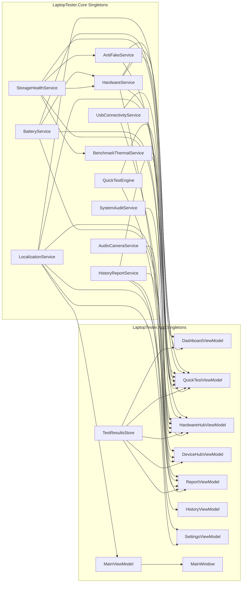
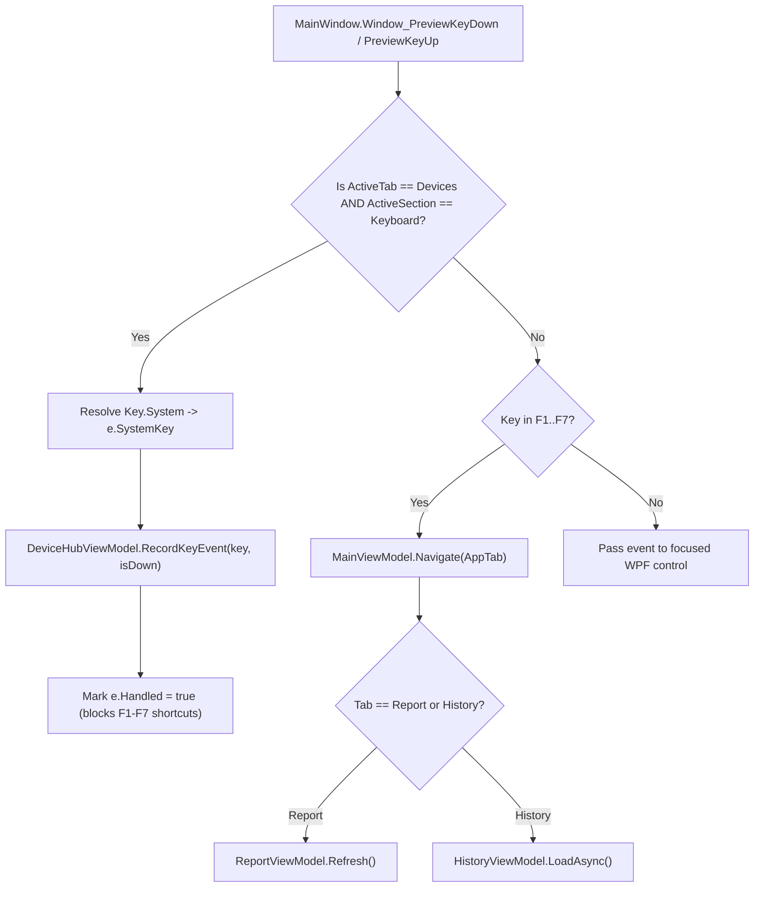
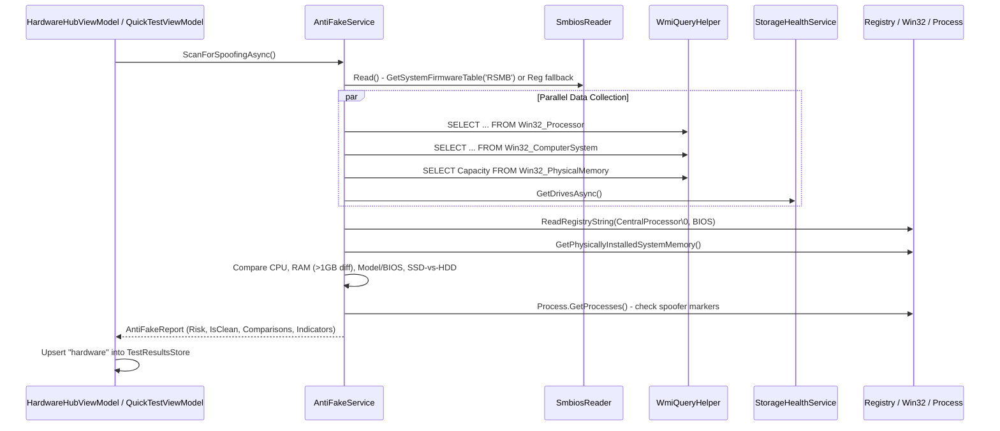
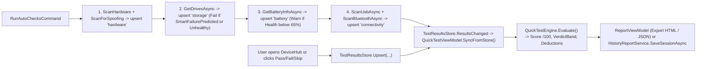
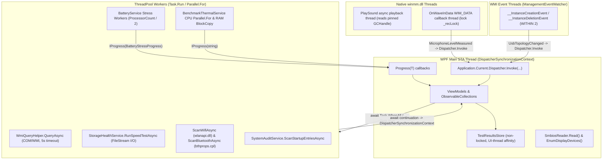

# LaptopTester — Technical Architecture, Functions, Flows & Threading Reference

> Grounded directly in the `LaptopTester` source tree (`LaptopTester.sln`, `.NET 10` / `net10.0-windows`).

---

## 1. System Overview & Technical Features

**LaptopTester** is a portable Windows 10/11 desktop hardware diagnostics, anti-spoofing audit, and peripheral verification application built on **.NET 10** (`net10.0-windows`) using **WPF**, **MVVM**, **WMI/CIM**, **Win32 P/Invoke**, and **Windows Registry** inspection.

### 1.1 Solution & Project Topology

| Project | Path | Output / Target | Key Dependencies | Purpose |
|---|---|---|---|---|
| **LaptopTester.Core** | [LaptopTester.Core.csproj](src/LaptopTester.Core/LaptopTester.Core.csproj) | Library (`net10.0-windows`) | `System.Management` `10.0.12` | Hardware/SMBIOS/WMI/Registry readers, native P/Invoke hardware probes, benchmarks, scoring engine, localization, JSON/HTML reporting |
| **LaptopTester.App** | [LaptopTester.App.csproj](src/LaptopTester.App/LaptopTester.App.csproj) | `WinExe` (`LaptopTester`, `net10.0-windows`, `UseWPF=true`) | `CommunityToolkit.Mvvm` `8.4.2`, `Microsoft.Extensions.DependencyInjection` `10.0.12` | WPF dark-themed desktop shell, ViewModels, Views, Converters, DI container, visual self-render mode |
| **LaptopTester.Tests** | [LaptopTester.Tests.csproj](tests/LaptopTester.Tests/LaptopTester.Tests.csproj) | xUnit Test Suite (`net10.0-windows`, `UseWPF=true`) | `Microsoft.NET.Test.Sdk`, `xunit`, `Xunit.SkippableFact`, refs to `Core` & `App` | Unit, live `Hardware`, and opt-in `Audible` tests across Core hardware/SMBIOS/audio/scoring and App ViewModels/converters |

### 1.2 Core Technical Features

1. **Multi-Source Hardware Discovery & Virtual Machine Detection**
   - Combines WMI (`root\cimv2`, `root\wmi`, `root\Microsoft\Windows\Storage`), 64-bit Windows Registry (`RegistryView.Registry64`), raw SMBIOS firmware tables (`GetSystemFirmwareTable('RSMB')`), Win32 memory/power/display APIs, and EDID monitor registry blobs (`EDID`).
   - Detects hypervisor environments (`VMware`, `VirtualBox`, `QEMU`, `Hyper-V`, `Virtual Machine`) and current execution privilege (`WindowsPrincipal` / `WindowsBuiltInRole.Administrator`).

2. **3-Source Anti-Fake Verification Audit**
   - Independently cross-checks **Windows/WMI**, **Registry / Win32 OS APIs**, and **SMBIOS firmware tables** (Type `0`, `1`, `2`, `4`, `17`, `22`) for CPU identity, total physical RAM, System Manufacturer/Model, and storage bus vs. physical media (`SSD` vs. `HDD`).
   - Scans running processes (`Process.GetProcesses()`) for known hardware-spoofing/DMI-editing tool names (`hwidspoofer`, `dmi_edit`, `dmiedit`, `amidewin`, `afudos`, `cheatengine`).

3. **Storage SMART Health & Raw Sequential Throughput Test**
   - Queries `Win32_DiskDrive`, `MSFT_PhysicalDisk`, `MSFT_StorageReliabilityCounter`, and `MSStorageDriver_FailurePredictStatus` (with `DriveInfo.GetDrives()` fallback) for bus type (`NVMe`, `SATA`, `USB`, `RAID`, `ATA`), media category (`SSD`, `HDD`, `SCM`), temperature, wear %, and SMART failure prediction.
   - Measures sequential write (`FileOptions.WriteThrough` + `Flush(true)`) and read (`FileOptions.SequentialScan`) throughput using `1 MB` random buffers (`128 MB` standalone, `96 MB` in combined benchmark).

4. **Battery Telemetry & Multi-Core Drain Stress Test**
   - Combines `GetSystemPowerStatus`, `Win32_Battery`, `root\wmi` battery classes (`BatteryStaticData`, `BatteryFullChargedCapacity`, `BatteryCycleCount`, `BatteryStatus`), and SMBIOS Type `22` fallback.
   - Runs a cancellable 30-second multi-core floating-point workload across `Environment.ProcessorCount / 2` threads while sampling discharge rate (`W`), voltage (`V`), percentage drop, and estimated remaining runtime every second.

5. **Thermal Telemetry, CPU/Memory Benchmark & System Audit**
   - Reads ACPI thermal zones (`MSAcpi_ThermalZoneTemperature` in tenths of Kelvin), processor utilization (`Win32_PerfFormattedData_PerfOS_Processor`), physical memory load (`GlobalMemoryStatusEx`), and drive SMART temperatures.
   - Runs single-core prime sieve (`limit: 220,000`), multi-core prime sieve (`limit: 350,000` across `Environment.ProcessorCount`), `64 MB × 12` `Buffer.BlockCopy` RAM bandwidth measurement, and optional sequential disk benchmark.
   - Audits Device Manager PnP errors (`Win32_PnPEntity WHERE ConfigManagerErrorCode <> 0`) and startup entries across `HKCU`/`HKLM` `Run`/`RunOnce` and Startup folders.

6. **Interactive Peripheral & Connectivity Diagnostics**
   - **Keyboard**: Live QWERTY visual matrix with key press/tested state tracking via window-level `PreviewKeyDown`/`PreviewKeyUp` interception.
   - **Display**: EDID panel identification + modal fullscreen pattern test (`Solid` 6-color cycle, `Gradient`, `Grid` 40×40 px alignment).
   - **Touchpad / Pointer**: WPF `InkCanvas` drawing surface with Left/Right/Middle click and scroll wheel counters.
   - **Audio (Speakers & Microphone)**: In-memory 44.1 kHz 16-bit stereo WAV synthesis (Left, Right, Both, 160–4000 Hz linear sweep with 30 ms fade) via `winmm.dll!PlaySound`; live 16 kHz 16-bit mono PCM microphone capture via `winmm.dll!waveIn*` with real-time RMS level metering and playback.
   - **USB Live Watcher**: Enumerates `Win32_USBController` and `Win32_PnPEntity` (`USB%`), classifies port/speed hints, and listens to live WMI `__InstanceCreationEvent` / `__InstanceDeletionEvent` (`WITHIN 2`).
   - **Wi-Fi, Bluetooth & Camera**: Native WLAN scan via `wlanapi.dll`, Bluetooth radio discovery via `bthprops.cpl` + WMI, and PnP camera enumeration.

7. **Guided 100-Point Quick Test Wizard, Reporting & Persistence**
   - Weighted 10-step evaluation (`QuickTestEngine`) with critical failure detection (`hardware`, `storage`, `display`) and 3 verdict bands (`Good`, `ConsiderCarefully`, `DoNotBuy`).
   - Session persistence as indented JSON in `%LocalAppData%\LaptopTester\history` and export to standalone JSON or print-styled HTML (`@media print` light-mode override).

8. **Shell Capabilities & Runtime Modes**
   - **Manifest ([app.manifest](src/LaptopTester.App/app.manifest))**: Runs with `asInvoker` (no forced UAC elevation), declares Windows 10/11 OS compatibility, and enables `PerMonitorV2` DPI awareness.
   - **Windows 11 Fluent Shell & DWM ([MainWindow.xaml](src/LaptopTester.App/Views/MainWindow.xaml), [MainWindow.xaml.cs](src/LaptopTester.App/Views/MainWindow.xaml.cs))**: Uses `WindowChrome` (`CaptionHeight=42`) for a custom Deep Black & Orange title bar and collapsible `NavigationView` left rail, calling `dwmapi.dll!DwmSetWindowAttribute` for dark mode (`20`), rounded outer corners (`33` = `DWMWCP_ROUND`), and border color (`34`) in `OnSourceInitialized`.
   - **Centralized UI Copy ([AppStrings.cs](src/LaptopTester.Core/Localization/AppStrings.cs))**: Provides English-only navigation labels, hardware verdicts, and plain-English guidance via `LocalizationService` (`ConcurrentDictionary`) consumed by `MainViewModel`, `DashboardViewModel`, `QuickTestViewModel`, `HardwareHubViewModel`, `DeviceHubViewModel`, `ReportViewModel`, `HistoryViewModel`, and `SettingsViewModel`.
   - **Visual Verification Mode ([App.xaml.cs](src/LaptopTester.App/App.xaml.cs))**: Passing `--verify-render <outDir>` forces `RenderMode.SoftwareOnly`, waits for initial scan, navigates tabs/subtabs, renders 5 views to PNG via `RenderTargetBitmap`, and calls `Shutdown(0)`.
- **Versioning, Installer & CI/CD**: Centralized version in [Directory.Build.props](Directory.Build.props) (surfaced dynamically in `MainViewModel.AppVersionLabel`). [ci.yml](.github/workflows/ci.yml) validates `Release` builds and offline unit tests on push/PR; [release.yml](.github/workflows/release.yml) supports manual `patch`/`minor`/`major`/`custom` version bumps (`workflow_dispatch`) or `v*` tag pushes to publish a self-contained single-file portable `.exe`, an Inno Setup 6 Windows installer ([LaptopTester.iss](installer/LaptopTester.iss)), and `SHA256SUMS.txt` via [build-release.ps1](scripts/build-release.ps1).

---

## 2. Dependency Injection & Application Structure

All services, stores, ViewModels, and the main window are registered as **singletons** in [App.xaml.cs](src/LaptopTester.App/App.xaml.cs#L95-L120):

---

## 3. Core Models & Services Reference

### 3.1 Domain Models (`LaptopTester.Core.Models`)

| File | Records / Enums | Key Fields |
|---|---|---|
| [HardwareModels.cs](src/LaptopTester.Core/Models/HardwareModels.cs) | `SystemSummary`, `CpuDetails`, `RamModuleDetails`, `RamDetails`, `GpuDetails`, `StorageDriveDetails`, `DisplayDetails`, `BatteryDetails`, `HardwareReport` | Aggregated system identity, per-slot memory, VRAM/driver, SMART/wear/temp, EDID panel metadata, battery capacity/rate/cycles |
| [AntiFakeModels.cs](src/LaptopTester.Core/Models/AntiFakeModels.cs) | `SpoofingRisk` (`None`, `Low`, `Medium`, `High`), `SourceComparisonRow`, `SpoofingIndicator`, `AntiFakeReport` | Side-by-side WMI vs. Registry vs. SMBIOS values, consistency flags, indicator severity, detected tool list |
| [DiagnosticModels.cs](src/LaptopTester.Core/Models/DiagnosticModels.cs) | `UsbControllerDetails`, `UsbDeviceDetails`, `WifiAdapterDetails`, `WifiNetworkSummary`, `BluetoothDetails`, `DriverIssueDetails`, `StartupEntryDetails`, `TemperatureSnapshot`, `BenchmarkReport` | Peripheral inventory, PnP error codes, startup entries, CPU/disk thermals, single/multi CPU scores, RAM GB/s, disk MB/s |
| [WorkflowModels.cs](src/LaptopTester.Core/Models/WorkflowModels.cs) | `TestStatus` (`Pending`, `Running`, `Passed`, `Warning`, `Failed`, `Skipped`), `VerdictBand` (`Good`, `ConsiderCarefully`, `DoNotBuy`), `TestResultEntry`, `ScoreDeduction`, `QuickTestSession` | Live test state store items, point deductions, serialized history/export payload |

### 3.2 Core Services (`LaptopTester.Core.Services`)

#### `WmiQueryHelper` ([WmiQueryHelper.cs](src/LaptopTester.Core/Services/WmiQueryHelper.cs))
- `QueryAsync(string query, string scopePath = @"root\cimv2", CancellationToken ct = default)`
  - Wraps `ManagementScope.Connect()` and `ManagementObjectSearcher.Get()` inside `Task.Run(..., ct)`.
  - Uses `EnumerationOptions` with `ReturnImmediately = true`, `Rewindable = false`, `Timeout = TimeSpan.FromSeconds(5)`.
  - Materializes each `ManagementBaseObject` into a case-insensitive `Dictionary<string, object?>` and immediately disposes each COM/WMI object.
  - Rethrows `OperationCanceledException`; swallows WMI provider/access exceptions and returns collected rows (empty list on failure).
- Typed extractors: `Str`, `ULong`, `Int`, `Bool`.

#### `SmbiosReader` ([SmbiosReader.cs](src/LaptopTester.Core/Services/SmbiosReader.cs))
- `Read()` returns `SmbiosSnapshot`.
- **Buffer acquisition**:
  1. Primary: `kernel32.dll!GetSystemFirmwareTable(0x52534D42 /* 'RSMB' */, 0, ...)` (two-call size query + buffer read).
  2. Fallback: 64-bit Registry `HKLM\SYSTEM\CurrentControlSet\Services\mssmbios\Data` value `SMBiosData`.
- **Binary parsing**:
  - Reads `tableLength` at offset `4`, begins walking structures at offset `8` up to `Math.Min(buffer.Length, 8 + tableLength)`.
  - Parses null-terminated string tables immediately following each fixed structure (`pos + length`) until double-null (`0x00 0x00`), stopping at Type `127` (End-of-table).
  - Decodes:
    - **Type 0** (BIOS): Vendor (`0x04`), Version (`0x05`), ReleaseDate (`0x08`).
    - **Type 1** (System): Manufacturer (`0x04`), ProductName (`0x05`), Serial (`0x07`), SKU (`0x19` if `length >= 0x1A`).
    - **Type 2** (Baseboard): Manufacturer (`0x04`), Product (`0x05`).
    - **Type 4** (Processor): Socket (`0x04`), Manufacturer (`0x07`), Version (`0x10`), MaxMhz (`0x14`), Cores/Threads (`0x23`/`0x25` for `length >= 0x26`, 16-bit extended counts at `0x2A`/`0x2E` for `length >= 0x30`).
    - **Type 17** (Memory Device): Size (`0x0C`, handling `0x7FFF` extended MB at `0x1C` and `0x8000` KB bitmask), DeviceLocator/Bank (`0x10`/`0x11`), MemoryType (`0x12`: DDR through LPDDR5), Speed (`0x15`, overridden by configured speed at `0x20` when `< 30000`), Manufacturer (`0x17`), Serial (`0x18`), PartNumber (`0x1A`).
    - **Type 22** (Portable Battery): Manufacturer (`0x05`), DeviceName (`0x08`), DesignCapacity (`0x0A` × multiplier `0x15`).

#### `HardwareService` ([HardwareService.cs](src/LaptopTester.Core/Services/HardwareService.cs))
- `ScanHardwareAsync(CancellationToken ct = default)` → `HardwareReport`:
  - Reads SMBIOS, runs 5 WMI queries (`Win32_ComputerSystem`, `Win32_OperatingSystem`, `Win32_Processor`, `Win32_PhysicalMemory`, `Win32_VideoController`) plus `StorageHealthService.GetDrivesAsync` and `BatteryService.GetBatteryInfoAsync` in parallel.
  - **RAM resolution (`BuildRamDetails`)**: Prefers `Win32_PhysicalMemory`, falls back to SMBIOS Type `17` slots. Usable RAM comes from `Win32_ComputerSystem.TotalPhysicalMemory` or `GlobalMemoryStatusEx`; total physical RAM uses `GetPhysicallyInstalledSystemMemory` (fallback to slot sum / usable RAM).
  - **GPU resolution (`BuildGpuDetails`, `ClassifyGpu`, `SelectPrimaryGpu`, `BuildGpuSummary`)**: Uses `Win32_VideoController` (`Name`, `DriverVersion`, `AdapterRAM`); if empty, enumerates 64-bit Registry class key `HKLM\SYSTEM\CurrentControlSet\Control\Class\{4d36e968-e325-11ce-bfc1-08002be10318}` (`DriverDesc`, `DriverVersion`). Classifies adapters via `GpuKind` (`Discrete` for NVIDIA/GeForce/Quadro/Radeon RX/Radeon Pro/FirePro/Xe MAX/Intel Arc A&B series, `Virtual / Basic` for Microsoft Basic/Remote/VMware/VirtualBox/Hyper-V/Parsec/QXL/Citrix, otherwise `Integrated`), picks primary GPU (`Discrete` → `Integrated` → `Virtual`), and formats `GpuSummary` with `(dGPU)` / `(iGPU)` tags hiding virtual adapters when real GPUs exist.
  - **Display & EDID (`EnumerateDisplays`, `ReadEdidPanels`)**: Enumerates up to 16 adapters via `user32.dll!EnumDisplayDevices` (`DISPLAY_DEVICE_ATTACHED_TO_DESKTOP = 0x1`, primary flag `0x4`) and `EnumDisplaySettings(..., ENUM_CURRENT_SETTINGS = -1)`. Reads raw 128+ byte EDID blobs under `HKLM\SYSTEM\CurrentControlSet\Enum\DISPLAY\*\*\Device Parameters\EDID`, unpacking the 3-letter 5-bit PNP manufacturer ID (`AUO`, `BOE`, `CMN`, `LGD`, `SDC`, `SHP`, `DEL`, `LEN`) and `0xFC` monitor descriptor string.
  - **Admin check (`IsCurrentProcessAdministrator`)**: Checks `WindowsIdentity.GetCurrent()` in `WindowsBuiltInRole.Administrator`.

#### `AntiFakeService` ([AntiFakeService.cs](src/LaptopTester.Core/Services/AntiFakeService.cs))
- `ScanForSpoofingAsync(CancellationToken ct = default)` → `AntiFakeReport`:
  1. **CPU Check** (`SpoofingRisk.High` on mismatch): Compares `Win32_Processor.Name`, `HKLM\HARDWARE\DESCRIPTION\System\CentralProcessor\0\ProcessorNameString`, and `SmbiosSnapshot.ProcessorVersion` using regex-normalized substring/equality matching (`Normalize` strips `(r)`, `(tm)`, `cpu`, `processor`, whitespace, and `@...`).
  2. **RAM Check** (`SpoofingRisk.High` on mismatch): Compares `Win32_PhysicalMemory` sum, `GetPhysicallyInstalledSystemMemory` (or `TotalPhysicalMemory`), and SMBIOS Type `17` sum. Flags discrepancy if `(Max - Min) > 1.0 GB`.
  3. **Model / BIOS Check** (`SpoofingRisk.Medium` on mismatch): Compares `Win32_ComputerSystem` (`Manufacturer Model`), `HKLM\HARDWARE\DESCRIPTION\System\BIOS` (`SystemManufacturer SystemProductName`), and SMBIOS Type `1`.
  4. **Storage Truth Check** (`SpoofingRisk.High` on mismatch): Checks internal drives (`!IsExternal`) where `Model` contains `"SSD"` while `MediaCategory` resolves to `"HDD"`.
  5. **Process Check** (`SpoofingRisk.Medium` if detected): Scans `Process.GetProcesses()` for `hwidspoofer`, `dmi_edit`, `dmiedit`, `amidewin`, `afudos`, `cheatengine`.

#### `BatteryService` ([BatteryService.cs](src/LaptopTester.Core/Services/BatteryService.cs))
- `GetBatteryInfoAsync(CancellationToken ct = default)` → `BatteryDetails`:
  - Calls `kernel32.dll!GetSystemPowerStatus` (AC flag, charging bit `8`, no-battery bit `128`, percentage, runtime).
  - Queries `Win32_Battery` (`root\cimv2`) and `BatteryStaticData`, `BatteryFullChargedCapacity`, `BatteryCycleCount`, `BatteryStatus` (`root\wmi`) in parallel, falling back to `SmbiosReader` Type `22` for `DesignedCapacity` and `Manufacturer`.
  - Computes `HealthPercent = Math.Clamp(full * 100.0 / designed, 0, 120)` and converts `mW`/`mV` to `W`/`V`.
- `RunStressTestAsync(int durationSeconds, IProgress<BatteryStressProgress> progress, CancellationToken ct)`:
  - Launches `Math.Max(1, Environment.ProcessorCount / 2)` background CPU workers running continuous `Math.Sqrt` loops.
  - Polls `GetBatteryInfoAsync` every `1000 ms`, estimates remaining runtime from discharge wattage or `%` drop rate, and reports `BatteryStressProgress`.

#### `StorageHealthService` ([StorageHealthService.cs](src/LaptopTester.Core/Services/StorageHealthService.cs))
- `GetDrivesAsync(CancellationToken ct = default)`:
  - Joins `Win32_DiskDrive` by disk `Index` (`DeviceId`) with `MSFT_PhysicalDisk` (`BusType`: `17=NVMe`, `11=SATA`, `7=USB`, `8=RAID`, `3=ATA`; `MediaType`: `4=SSD`, `3=HDD`, `5=SCM`; `HealthStatus`: `0=Healthy`, `1=Warning`, `2=Unhealthy`), `MSFT_StorageReliabilityCounter` (`Temperature`, `Wear`), and `MSStorageDriver_FailurePredictStatus` (`PredictFailure`).
  - Falls back to `DriveInfo.GetDrives()` (fixed/removable ready volumes) if WMI returns 0 drives.
- `RunSpeedTestAsync(string? driveRoot = null, int sizeMb = 128, CancellationToken ct = default)`:
  - Writes random `1 MB` chunks to `%TEMP%\laptoptester_bench_<guid>.tmp` (or `driveRoot`) with `FileOptions.WriteThrough` + `fs.Flush(true)`, reads sequentially with `FileOptions.SequentialScan`, computes `MB/s`, and deletes the temp file in `finally`.

#### `BenchmarkThermalService` ([BenchmarkThermalService.cs](src/LaptopTester.Core/Services/BenchmarkThermalService.cs))
- `CaptureThermalSnapshotAsync(CancellationToken ct = default)` → `TemperatureSnapshot`:
  - Queries `MSAcpi_ThermalZoneTemperature` (`(raw - 2732) / 10.0`, keeping values in `(5, 130) °C`), `Win32_PerfFormattedData_PerfOS_Processor` (`_Total`), drive SMART temperatures, and `GlobalMemoryStatusEx.dwMemoryLoad`.
- `RunBenchmarkAsync(bool includeDisk, IProgress<string>? status = null, CancellationToken ct = default)` → `BenchmarkReport`:
  - Single-core prime trial division up to `220,000` (`threads: 1`).
  - Multi-core prime trial division up to `350,000` (`threads: Environment.ProcessorCount`) via `Parallel.For` + `Interlocked.Add`.
  - Score formula: `totalPrimes / Math.Max(0.05, elapsedSeconds) / 100.0`.
  - Memory bandwidth: allocates two `64 MB` arrays, warms up once, copies `12` iterations via `Buffer.BlockCopy`, returns `GB/s`.
  - Optional disk test: calls `_storageService.RunSpeedTestAsync(sizeMb: 96, ct: ct)`.
  - Tier classification: `>= 12000` (`High Performance / Workstation`), `>= 6000` (`Mainstream / Balanced`), else (`Entry / Ultralight`).

#### `SystemAuditService` ([SystemAuditService.cs](src/LaptopTester.Core/Services/SystemAuditService.cs))
- `ScanDriverIssuesAsync`: Queries `Win32_PnPEntity WHERE ConfigManagerErrorCode <> 0` and maps common Windows Device Manager codes (`1, 10, 12, 18, 22, 28, 31, 43, 45`).
- `ScanStartupEntriesAsync`: Inspects 64-bit `HKCU`/`HKLM` `Run` & `RunOnce` keys and `Startup`/`CommonStartup` folders (ignoring `desktop.ini`). Marks entries referencing `\Temp\`, `powershell`, or `wscript` as `"Review"`.

#### `AudioCameraService` ([AudioCameraService.cs](src/LaptopTester.Core/Services/AudioCameraService.cs))
- **Device discovery**: `winmm.dll!waveOutGetNumDevs`/`waveOutGetDevCaps` and `waveInGetNumDevs`/`waveInGetDevCaps`; `EnumerateCamerasAsync` queries `Win32_PnPEntity WHERE PNPClass = 'Camera' OR PNPClass = 'Image'`.
- **Stereo & sweep output**: `BuildStereoWave` constructs a RIFF/WAVE PCM buffer (`44,100 Hz`, `2 ch`, `16-bit`) with phase accumulation (for smooth frequency sweeps `160 Hz → 4000 Hz`) and `30 ms` linear fade-in/out (`amplitude = 14000`). Pins the byte array with `GCHandle.Alloc(..., GCHandleType.Pinned)` and plays via `PlaySound(..., SND_MEMORY | SND_ASYNC = 0x0005)`. `StopPlayback()` calls `PlaySound(0, 0, SND_PURGE = 0x0040)` and frees the `GCHandle`.
- **Microphone recording**: `StartMicrophoneRecording()` opens `WAVE_MAPPER` (`-1`) at `16,000 Hz`, `1 ch`, `16-bit` with `CALLBACK_FUNCTION` (`0x00030000`), allocates 4 pinned `1600`-byte (`50 ms`) buffers + unmanaged `WAVEHDR` structs (`Marshal.AllocHGlobal`), prepares/adds them, and starts `waveInStart`. `OnWaveInData` copies PCM bytes into `_recordedPcm`, computes normalized RMS (`Math.Min(1.0, rms * 3.2)`), fires `MicrophoneLevelMeasured`, and re-queues the buffer via `waveInAddBuffer`. `PlayRecordedMicrophone()` wraps `_recordedPcm` with a `16 kHz` mono WAV header (`WrapMonoPcmAsWav`) and plays it via `PlayWaveBytes`.

#### `UsbConnectivityService` ([UsbConnectivityService.cs](src/LaptopTester.Core/Services/UsbConnectivityService.cs))
- `ScanUsbAsync`: Queries `Win32_USBController` and `Win32_PnPEntity WHERE DeviceID LIKE 'USB%'`, infers port type (`USB-C` if `Type-C`/`UCSI`) and speed label (`USB4 / 40 Gbps`, `USB 3.1 / 10 Gbps`, `USB 3.0 / 5 Gbps`, `USB 2.0 / Standard`) from device names, and sorts non-hubs before hubs.
- `StartUsbWatcher` / `StopUsbWatcher`: Manages two WMI `ManagementEventWatcher` subscriptions (`__InstanceCreationEvent` and `__InstanceDeletionEvent` `WITHIN 2` on `Win32_USBControllerDevice`), emitting `UsbTopologyChanged`.
- `ScanWifiAsync`: Uses `wlanapi.dll` (`WlanOpenHandle(2, ...)`, `WlanEnumInterfaces`, `WlanGetAvailableNetworkList`, `WlanFreeMemory`, `WlanCloseHandle`), maps `WLAN_INTERFACE_STATE` (`MapWlanInterfaceState`: `0..7`) and `DOT11_PHY_TYPE` (`MapPhyType`: `4=802.11a`, `5=802.11b`, `6=802.11g`, `7=Wi-Fi 4`, `8=Wi-Fi 5`, `9=WiGig`, `10=Wi-Fi 6/6E`, `11=Wi-Fi 7`), deduplicates by `Ssid` keeping max signal, and orders descending by `SignalPercent`.
- `ScanBluetoothAsync`: Uses `bthprops.cpl!BluetoothFindFirstRadio` + `BluetoothGetRadioInfo` (formats 6-byte MAC address) alongside `Win32_PnPEntity WHERE PNPClass = 'Bluetooth'`.

#### `QuickTestEngine` ([QuickTestEngine.cs](src/LaptopTester.Core/Services/QuickTestEngine.cs))
- Defines 10 `StandardSteps` totaling `100` points:
  `hardware` (18), `storage` (14), `battery` (14), `display` (12), `keyboard` (10), `touchpad` (8), `speaker` (6), `microphone` (6), `camera` (6), `connectivity` (6).
- `Evaluate(IEnumerable<TestResultEntry>)`:
  - Takes the most recent `TestResultEntry` per `TestId`.
  - `Failed` deducts `weight` (and sets `hasCriticalFail = true` if `id` is `"hardware"`, `"storage"`, or `"display"`).
  - `Warning` deducts `Math.Max(2, weight / 2)`.
  - Clamps score to `[0, 100]` and computes `VerdictBand`:
    - `DoNotBuy`: `hasCriticalFail || score < 60`
    - `ConsiderCarefully`: `score < 82 || deductions.Count >= 2`
    - `Good`: otherwise.

#### `HistoryReportService` ([HistoryReportService.cs](src/LaptopTester.Core/Services/HistoryReportService.cs))
- Default directory: `%LocalAppData%\LaptopTester\history` (overridable via constructor for tests).
- `SaveSessionAsync`: Writes `{Timestamp:yyyyMMdd_HHmmss}_{Id}.json`.
- `LoadSessionsAsync`: Reads `*.json` ordered descending by filename.
- `DeleteSession` / `ClearAllHistory`: Deletes matching `*_{sessionId}.json` or all `*.json` files synchronously.
- `ExportJsonAsync` / `ExportHtmlAsync`: Serializes `QuickTestSession` to JSON or a self-contained HTML report with HTML-encoded fields and `@media print` styling.

---

## 4. Presentation Layer (`LaptopTester.App`)

### 4.1 ViewModels & State Store

| Component | File | Responsibilities |
|---|---|---|
| `TestResultsStore` | [TestResultsStore.cs](src/LaptopTester.App/ViewModels/TestResultsStore.cs) | Singleton `ObservableCollection<TestResultEntry>` + `ResultsChanged`; `Upsert` replaces existing entry by `TestId` or appends |
| `MainViewModel` | [MainViewModel.cs](src/LaptopTester.App/ViewModels/MainViewModel.cs) | Top-level `AppTab` routing (`Dashboard`..`Settings`), collapsible left rail (`NavPaneWidth`, `ToggleNavPane`), `GoBack` handling, language toggle, privilege/session badges, auto-refresh on `Report` (`Refresh`) and `History` (`LoadAsync`) |
| `DashboardViewModel` | [DashboardViewModel.cs](src/LaptopTester.App/ViewModels/DashboardViewModel.cs) | Auto-runs `ScanSystemAsync` at construction, updates `"hardware"` in `TestResultsStore`, relays tile navigation (`Hardware`, `Battery`, `AntiFake`, `Thermal`) and Quick Test launch |
| `QuickTestViewModel` | [QuickTestViewModel.cs](src/LaptopTester.App/ViewModels/QuickTestViewModel.cs) | Maintains 10 `WizardStepItem` rows synced with `TestResultsStore`, tracks `CheckedCount` and `VerdictBand`, runs 4-stage `RunAutoChecksAsync`, jumps to `DeviceHubView` sections, supports manual Pass/Fail/Skip, saves `QuickTestSession` |
| `HardwareHubViewModel` | [HardwareHubViewModel.cs](src/LaptopTester.App/ViewModels/HardwareHubViewModel.cs) | Manages 5 sub-tabs (`Hardware`, `AntiFake`, `Battery`, `Thermal`, `StorageAudit`), auto-scans hardware on startup, runs 30s cancellable battery stress test, storage speed test, driver/startup audit, thermal snapshot, and full benchmark |
| `DeviceHubViewModel` | [DeviceHubViewModel.cs](src/LaptopTester.App/ViewModels/DeviceHubViewModel.cs) | Manages 9 sections + Hub grid (`Keyboard`, `Display`, `Touchpad`, `Audio`, `USB`, `Connectivity`, `Camera`, `Charger`, `Physical`); maintains 6-row QWERTY `KeyTileState` grid with `Key` enum alias matching (`KeyTileState.KeyValue` in `RecordKeyEvent`), touchpad counters, audio/mic commands, USB watcher & connectivity triggers |
| `ReportViewModel`, `HistoryViewModel`, `SettingsViewModel` | [ReportHistorySettingsViewModels.cs](src/LaptopTester.App/ViewModels/ReportHistorySettingsViewModels.cs) | Report scoring/notes/SaveFileDialog HTML+JSON export (`Process.Start` opens exported HTML), saved session management + detail inspection, VI/EN toggle + Explorer launch |

### 4.2 Views & Value Converters

- **Views**: [MainWindow](src/LaptopTester.App/Views/MainWindow.xaml), [DashboardView](src/LaptopTester.App/Views/DashboardView.xaml), [QuickTestView](src/LaptopTester.App/Views/QuickTestView.xaml), [HardwareHubView](src/LaptopTester.App/Views/HardwareHubView.xaml), [DeviceHubView](src/LaptopTester.App/Views/DeviceHubView.xaml), [FullScreenTestWindow](src/LaptopTester.App/Views/FullScreenTestWindow.xaml), [ReportView](src/LaptopTester.App/Views/ReportView.xaml), [HistoryView](src/LaptopTester.App/Views/HistoryView.xaml), [SettingsView](src/LaptopTester.App/Views/SettingsView.xaml).
- **Converters ([Converters.cs](src/LaptopTester.App/Converters/Converters.cs))**: `BoolToVisibilityConverter` (`"invert"`), `InverseBoolConverter`, `NullToVisibilityConverter` (`"invert"`), `StatusToBrushConverter`, `StatusToBgBrushConverter`, `VerdictToBrushConverter`, `VerdictToBgBrushConverter`, `EqualsToBoolConverter`, `EqualsToVisibilityConverter`, `PositiveIntToVisibilityConverter`, `ZeroIntToVisibilityConverter`.

---

## 5. End-to-End Execution Flows

### 5.1 Application Startup & Initial Scan Flow

1. `App.OnStartup` hooks `DispatcherUnhandledException`, checks `--verify-render <outDir>`, builds the DI `ServiceProvider`, and resolves `MainWindow`.
2. Resolving `MainWindow` constructs `MainViewModel` and all child singleton ViewModels eagerly:
   - `DashboardViewModel` constructor invokes `_ = ScanSystemAsync()`.
   - `HardwareHubViewModel` constructor invokes `_ = RefreshHardwareAsync()`.
   - `DeviceHubViewModel` constructor attaches event handlers to `UsbConnectivityService.UsbTopologyChanged` and `AudioCameraService.MicrophoneLevelMeasured`, builds keyboard tiles, and synchronously calls `RefreshAudioDevices()`.
   - `MainViewModel` navigates to `AppTab.Dashboard` and shows `MainWindow`.
3. If `--verify-render` is active, `RunVisualVerificationAsync` delays `2500 ms`, sequentially captures 5 screens (`Dashboard`, `QuickTest`, `AntiFake`, `Battery`, `Keyboard`) using `RenderTargetBitmap` at `DispatcherPriority.Render`, and shuts down cleanly.

### 5.2 Navigation & Global Keyboard Routing Flow

- Pressing `←` (`GoBackCommand`) in `MainWindow`: if currently on `AppTab.Devices` with `ActiveSection != "Hub"`, returns to `"Hub"`; otherwise navigates to `AppTab.Dashboard`.

### 5.3 3-Source Anti-Fake Verification Flow

### 5.4 Guided 10-Step Quick Test & Reporting Flow

### 5.5 Battery Stress Test Flow

1. User clicks **Start / Stop 30s Drain Test** (`ToggleBatteryStressCommand`).
2. If `IsStressRunning` is already `true`, calls `_stressCts?.Cancel()` and returns immediately.
3. Otherwise creates a `CancellationTokenSource`, captures initial `BatteryDetails`, spawns `Environment.ProcessorCount / 2` compute tasks (`Math.Sqrt` loops), and loops `sec = 1..30`:
   - `await Task.Delay(1000, ct)`
   - `await GetBatteryInfoAsync(ct)`
   - Reports `BatteryStressProgress` to UI via `IProgress<T>`.
4. In `finally`, cancels `linkedCts` and awaits `Task.WhenAll(workers)`.
5. On completion, `HardwareHubViewModel` calls `CheckBatteryAsync()` to refresh final telemetry and update `"battery"` in `TestResultsStore`.

### 5.6 Audio Playback & Live Microphone Recording Flow

- **Speaker Test**: `PlayStereoTest` / `PlaySweepTest` builds a 44.1 kHz 16-bit stereo WAV byte array in memory, pins it via `GCHandle`, and plays it asynchronously with `PlaySound(..., SND_MEMORY | SND_ASYNC)`. Calling any play command or `StopAudioCommand` calls `StopPlayback()` (`SND_PURGE` + `GCHandle.Free()`) first.
- **Microphone Test**:
  1. `ToggleMicRecordingCommand` calls `StartMicrophoneRecording()`.
  2. Clears `_recordedPcm`, opens `waveInOpen` with `CALLBACK_FUNCTION` (`_waveInCallback` kept in an instance field to prevent GC collection), prepares and queues 4 × `1600`-byte buffers (`50 ms` each at `16 kHz` 16-bit mono), and calls `waveInStart`.
  3. Native `winmm` delivers `WIM_DATA` (`0x3C0`) callbacks to `OnWaveInData`, which appends PCM bytes under `_recLock`, computes RMS level (`MicrophoneLevelMeasured`), and re-queues the buffer with `waveInAddBuffer`.
  4. Second toggle calls `StopMicrophoneRecording()` (`_isRecording = false` → `waveInStop` → `waveInReset` → `waveInUnprepareHeader` → `waveInClose` → `Marshal.FreeHGlobal` + `GCHandle.Free`), sets `HasRecordedAudio`, and enables `PlayRecordedMicCommand` (`WrapMonoPcmAsWav` → `PlaySound`).

### 5.7 Fullscreen Display & Touchpad Interactive Flows

- **Display Test**: `DeviceHubViewModel.LaunchDisplayTestCommand` fires `LaunchDisplayFullScreenRequested(mode)` → `MainWindow` instantiates `FullScreenTestWindow(mode)` (`WindowStyle="None"`, `WindowState="Maximized"`, `Topmost="True"`) and blocks via `win.ShowDialog()`.
  - `"Solid"` cycles `Black → White → Red → Green → Blue → 50% Gray` on Left-Click/`Space`/`Right`/`Enter` and reverses on Right-Click/`Left`; `"Gradient"` renders a horizontal black-to-white `LinearGradientBrush`; `"Grid"` renders a `40×40` tiled `DrawingBrush`; `Esc` closes the dialog.
- **Touchpad Test**: `DeviceHubView.xaml.cs` handles `PreviewMouseDown` and `PreviewMouseWheel` directly on `TouchpadCanvas` (`InkCanvas`), incrementing `LeftClicks`, `RightClicks`, `MiddleClicks`, and `WheelEvents` on `DeviceHubViewModel`, while `OnClearTouchpadClick` clears `TouchpadCanvas.Strokes` and resets counters.

---

## 6. Threading, Concurrency & Synchronization Model

`LaptopTester` relies on four distinct execution contexts: the **WPF STA UI Thread**, **.NET ThreadPool Worker Threads**, **Native `winmm.dll` Audio Threads**, and **WMI MTA Event Watcher Threads**.

### 6.1 Thread Inventory & Responsibilities

| Thread / Pool | Components Running There | Mechanism | Resumption / UI Marshaling |
|---|---|---|---|
| **WPF Main Thread (STA)** | `App`, `MainWindow`, `FullScreenTestWindow`, all Views & ViewModels, `TestResultsStore`, `SmbiosReader.Read()`, `HardwareService.EnumerateDisplays()`, `AntiFakeService.DetectSuspectedTools()`, `AudioCameraService.GetAudioDevices()`, `HistoryReportService.DeleteSession`/`ClearAllHistory` | WPF message pump & `DispatcherSynchronizationContext` | Default `await` continuations (no `ConfigureAwait(false)` is used) automatically resume here |
| **ThreadPool (`Task.Run`)** | `WmiQueryHelper.QueryAsync`, `StorageHealthService.RunSpeedTestAsync`, `BenchmarkThermalService` CPU/RAM passes, `SystemAuditService.ScanStartupEntriesAsync`, `UsbConnectivityService.ScanWifiAsync` & radio part of `ScanBluetoothAsync`, `BatteryService.RunStressTestAsync` compute workers | `Task.Run(..., ct)` and `Parallel.For` | `Task` completion posts continuation to captured `DispatcherSynchronizationContext`; `IProgress<T>` posts to captured `SynchronizationContext` |
| **`winmm.dll` Audio Capture Thread** | `AudioCameraService.OnWaveInData` (`WaveInProc`) | Native Windows multimedia callback (`CALLBACK_FUNCTION`) | `DeviceHubViewModel` marshals `MicrophoneLevelMeasured` via `Application.Current?.Dispatcher.Invoke(...)` |
| **`winmm.dll` Async Playback Thread** | OS audio playback inside `PlaySound(..., SND_MEMORY \| SND_ASYNC)` | Internal OS multimedia thread reading pinned `GCHandle` | Stopped synchronously from UI thread via `PlaySound(..., SND_PURGE)` + `GCHandle.Free()` |
| **WMI Event Watcher Threads** | `ManagementEventWatcher.EventArrived` in `UsbConnectivityService` | Background WMI COM/MTA event threads polling every `2 s` | `DeviceHubViewModel` marshals `UsbTopologyChanged` via `Application.Current?.Dispatcher.Invoke(...)`, updating `UsbWatcherLog` and starting `_ = ScanUsbAsync()` |

### 6.2 Parallelism & Fan-Out Patterns

1. **`Task.WhenAll` Concurrent Queries**:
   - `HardwareService.ScanHardwareAsync`: 7 concurrent tasks (5 WMI queries + `GetDrivesAsync` [which fans out 4 WMI queries] + `GetBatteryInfoAsync` [which fans out 5 WMI queries] = **14 WMI queries** executing in parallel across the ThreadPool).
   - `AntiFakeService.ScanForSpoofingAsync`: 4 concurrent tasks (`Win32_Processor`, `Win32_ComputerSystem`, `Win32_PhysicalMemory`, `GetDrivesAsync`).
   - `BenchmarkThermalService.CaptureThermalSnapshotAsync`: 3 concurrent tasks (`MSAcpi_ThermalZoneTemperature`, `Win32_PerfFormattedData_PerfOS_Processor`, `GetDrivesAsync`).
   - `HardwareHubViewModel.RunSystemAuditAsync`: 2 concurrent tasks (`ScanDriverIssuesAsync`, `ScanStartupEntriesAsync`).
   - `DeviceHubViewModel.ScanConnectivityAsync`: 2 concurrent tasks (`ScanWifiAsync`, `ScanBluetoothAsync`).
   - `UsbConnectivityService.ScanUsbAsync`: 2 concurrent WMI queries (`Win32_USBController`, `Win32_PnPEntity`).
2. **Data-Parallel Compute**:
   - `BenchmarkThermalService.RunCpuPass`: `Parallel.For(0, Environment.ProcessorCount, ...)` using thread-local `long count` and `Interlocked.Add(ref totalOps, count)` to avoid false sharing/lock contention.
   - `BatteryService.RunStressTestAsync`: Spawns `Environment.ProcessorCount / 2` independent `Task.Run` loops using `CancellationToken.None` on the `Task.Run` parameter while polling `linkedCts.Token.IsCancellationRequested` inside the loop, guaranteeing clean `await Task.WhenAll(workers)` draining in `finally`.

### 6.3 Synchronization Primitives, Re-Entrancy Guards & Edge Cases Observed in Code

- **Locks & Volatile State**:
  - `AudioCameraService._recLock` (`object`): Synchronizes all reads, writes, and resets of `_recordedPcm` (`MemoryStream`) between the `winmm` callback thread and the UI thread.
  - `AudioCameraService._isRecording` (`volatile bool`): Prevents `OnWaveInData` from recording or re-queuing `WAVEHDR` buffers once `StopMicrophoneRecording()` starts teardown.
  - `LocalizationService.Table`: Uses `ConcurrentDictionary<string, (string Vi, string En)>` for thread-safe lookups.
  - `Interlocked.Add`: Aggregates prime counts across `Parallel.For` threads in `BenchmarkThermalService`.
- **Re-Entrancy & UI Busy Guards**:
  - `DashboardViewModel.ScanSystemAsync` guards with `if (IsScanning) return;`.
  - `QuickTestViewModel.RunAutoChecksAsync` guards with `if (IsRunningAuto) return;`.
  - `HardwareHubViewModel.ToggleBatteryStressAsync` toggles cancellation when `IsStressRunning` is true; other commands disable their buttons in XAML via `IsEnabled="{Binding IsBusy, Converter={StaticResource InverseBool}}"`.
- **Observed Concurrency & Lifecycle Nuances**:
  1. **Startup dual hardware scan**: Both `DashboardViewModel` and `HardwareHubViewModel` invoke `ScanHardwareAsync()` fire-and-forget from their constructors during DI graph creation, so two full hardware scans run concurrently at startup (both services are stateless, and `TestResultsStore.Upsert` only executes back on the UI thread).
  2. **`TestResultsStore` thread affinity**: `ObservableCollection<TestResultEntry>` and `Upsert()` have no internal lock and assume callers invoke `Upsert` on the WPF UI thread after `await` resumes on `DispatcherSynchronizationContext`.
  3. **Synchronous `Dispatcher.Invoke` in `winmm` / WMI callbacks**: `DeviceHubViewModel` uses synchronous `Dispatcher.Invoke` inside `MicrophoneLevelMeasured` and `UsbTopologyChanged`. Under normal operation this updates `MicLevelPercent` and `UsbWatcherLog` safely on the UI thread; during `StopMicrophoneRecording()` on the UI thread, if a `WIM_DATA` callback were simultaneously waiting inside synchronous `Dispatcher.Invoke` while the UI thread waited inside `waveInReset()`/`waveInClose()`, `Dispatcher.BeginInvoke` (`InvokeAsync`) would avoid a potential callback-vs-UI deadlock.
  4. **USB watcher lifecycle**: `StartUsbWatcher()` is activated the first time the user enters the `"USB"` section in `DeviceHubView` and stays active until `DeviceHubViewModel.Dispose()` (`App.OnExit` → `_serviceProvider?.Dispose()`).
  5. **Unmanaged memory pinning**: `AudioCameraService` pins both playback WAV arrays (`_playbackHandle`) and recording PCM buffers (`_bufHandles`) via `GCHandleType.Pinned`, and keeps `_waveInCallback` referenced as a field so the GC neither relocates buffers nor collects the callback delegate while `winmm.dll` holds native pointers.
